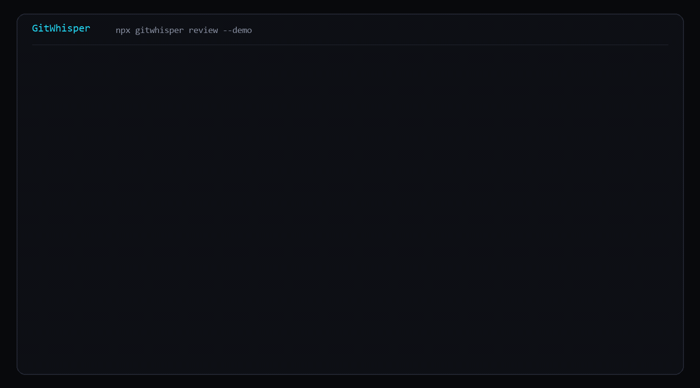
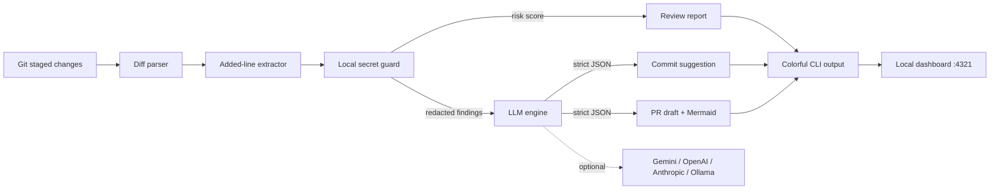

<div align="center">

```text
╔══════════════════════════════════════════════════════════════╗
║                                                              ║
║   ██████╗ ██╗████████╗    ██╗    ██╗██╗  ██╗███████╗██████╗  ║
║  ██╔════╝ ██║╚══██╔══╝    ██║    ██║██║  ██║██╔════╝██╔══██╗ ║
║  ██║  ███╗██║   ██║       ██║ █╗ ██║███████║█████╗  ██████╔╝ ║
║  ██║   ██║██║   ██║       ██║███╗██║██╔══██║██╔══╝  ██╔══██╗ ║
║  ╚██████╔╝██║   ██║       ╚███╔███╔╝██║  ██║███████╗██║  ██║ ║
║   ╚═════╝ ╚═╝   ╚═╝        ╚══╝╚══╝ ╚═╝  ╚═╝╚══════╝╚═╝  ╚═╝ ║
║                                                              ║
╚══════════════════════════════════════════════════════════════╝
```

### Your last line of defense before `git push`.

**GitWhisper catches leaked secrets, writes clean Conventional Commits, and turns messy diffs into PR descriptions developers actually want to read.**

[](https://github.com/priyanshkk/gitwhisper/actions/workflows/ci.yml)
[](https://www.npmjs.com/package/gitwhisper)
[](https://www.typescriptlang.org/)
[](LICENSE)
[](CONTRIBUTING.md)



<sub>No API key? No repo setup? The demo runs in about five seconds.</sub>

</div>

---

## The hook

```text
BEFORE   git add . && git commit -m "fix stuff"          →  mystery commit, leaked Stripe key, zero context
AFTER    gw commit                                       →  feat(payments): add stripe charge support
WITH GW  gw review && gw pr                              →  secret guard + review score + PR body with Mermaid diagram
```

One tool. Three problems gone. Everything runs locally first — your code and keys never need to leave your machine.

---

## Interactive terminal demo

```bash
npx gitwhisper review --demo
```

```text
┌  GitWhisper review · demo mode
│
◆  Local secret scan complete
│
Security guard  1 critical · 1 medium
  CRITICAL  stripe-live-key  src/services/payments.ts:3
            masked: sk_l••••••••mN0
  MEDIUM    high-entropy-literal  src/services/payments.ts:3
            masked: sk_l••••••••mN0
│
Review score  ███████░░░  74/100
3 files changed; 1 critical and 0 high security findings need attention before sharing.
│
Suggestions
  1. stripe-live-key at src/services/payments.ts:3 — Roll the live key immediately and check Stripe logs for misuse.
  2. high-entropy-literal at src/services/payments.ts:3 — Confirm this literal is not a credential; use a secret manager if it is.
  3. Replace 1 console call(s) with a structured logger before shipping.
│
Diff: 3 files · 30 additions · 0 deletions
Engine: offline-heuristic · demo data, no files touched
└  Demo complete — GitWhisper is working.
```

```bash
npx gitwhisper commit --demo --dry-run
```

```text
┌  GitWhisper commit · demo mode
│
◆  Commit message drafted
│
Secret guard
  CRITICAL  stripe-live-key  src/services/payments.ts:3
│
Suggested commit
  feat(payments): add stripe charge support and inr formatting
  src/services/payments.ts (20+ / 0-)
  src/services/payments.test.ts (7+ / 0-)
  README.md (2+ / 0-)
│
Confidence: 76% · engine: offline-heuristic
└  Demo complete — no repository changes made.
```

---

## Features

- 🛡️ **Local secret guard** — 10 curated rules plus Shannon entropy catch AWS, GitHub, OpenAI, Stripe, private keys and JWTs before they ship.
- ✍️ **Clean commits automatically** — Conventional Commit messages with scope, body and confidence, generated from the staged diff.
- 📝 **PRs that explain themselves** — title, changelog, testing notes, risks and a Mermaid impact diagram in one command.
- 🤖 **BYOK or fully offline** — Gemini, OpenAI, Anthropic, local Ollama, or deterministic heuristics with zero network access.
- 📊 **Local web dashboard** — repo health, commit velocity, secret findings and review insights at `localhost:4321`.
- ⚡ **Fast and private** — native `fetch`, ESM TypeScript, redacted findings, localhost-only server and no telemetry.

---

## 30-second quick start

```bash
# Try the full experience with zero setup
npx gitwhisper review --demo

# Scan your real staged changes
git add .
npx gitwhisper review

# Draft and create a clean commit
npx gitwhisper commit

# Generate a PR description with a Mermaid diagram
npx gitwhisper pr

# Open the local dashboard
npx gitwhisper dashboard --demo
```

Install globally if you prefer a short alias:

```bash
npm install -g gitwhisper
gw review
gw commit
gw pr
gw ui
```

Use Ollama for 100% offline AI:

```bash
ollama pull llama3.2
gw config --provider ollama --ollama-model llama3.2
gw review
```

Bring your own key instead:

```bash
gw config --provider gemini --api-key YOUR_KEY
# or: gw config --provider openai --api-key YOUR_KEY
# or: gw config --provider anthropic --api-key YOUR_KEY
```

Keys are stored locally at `~/.gitwhisper/config.json` with `0o600` permissions where supported. Environment variables such as `GEMINI_API_KEY` also work.

---

## Architecture



The local scanner is the source of truth. If a model returns a higher score than the local heuristic score, GitWhisper keeps the lower one. See [docs/ARCHITECTURE.md](docs/ARCHITECTURE.md) for the full design.

---

## Command reference

| Command | What it does |
| --- | --- |
| `gw review` | Scan staged changes and print a security-aware review |
| `gw review --demo` | Run a realistic demo with no key, repo or network |
| `gw commit` | Draft and optionally create a Conventional Commit |
| `gw commit --dry-run` | Preview the message without touching git |
| `gw pr` | Generate a Markdown PR body and Mermaid impact diagram |
| `gw config` | Manage provider, keys, Ollama and offline mode |
| `gw ui` / `gw dashboard` | Start the dashboard on `http://localhost:4321` |

Useful flags: `--json`, `--yes`, `--output <file>`, `--provider <name>`, `--offline`, `--cwd <dir>`.

---

## Dashboard preview

The dashboard is a React + Vite + Tailwind app served by the CLI itself. It shows repository health, review score, secret findings, commit velocity, commit-type distribution, top changed files and recent commits.

```bash
npm run build
node dist/cli/index.js dashboard --demo
```

If `web/dist` is not built, an embedded fallback dashboard still serves the same local APIs.

---

## Roadmap

- [x] Local secret scanner with redaction and entropy analysis
- [x] Conventional Commit generation
- [x] PR drafts with Mermaid impact summary
- [x] Gemini, OpenAI, Anthropic and Ollama providers
- [x] Offline heuristic fallback and `--demo` mode
- [x] React + Tailwind local dashboard
- [x] Vitest, Biome, Husky, GitHub Actions and Docker
- [ ] VS Code extension
- [ ] GitHub App with inline PR comments
- [ ] Custom secret-rule packs
- [ ] Commit-velocity trends across branches
- [ ] Optional encrypted team dashboard

---

## Contributing

Contributions are very welcome. Read [CONTRIBUTING.md](CONTRIBUTING.md) for setup, repository conventions and the PR checklist.

```bash
git clone https://github.com/priyanshkk/gitwhisper.git
cd gitwhisper
npm install
npm run build
npm test
npm run demo
```

Please keep demo paths deterministic, add tests for scanner changes and never include real secrets in issues or pull requests.

---

## License

MIT © 2026 Priyanshu. See [LICENSE](LICENSE).

<div align="center">

**If GitWhisper saved you from one bad commit, give it a ⭐ and share the demo.**

</div>
