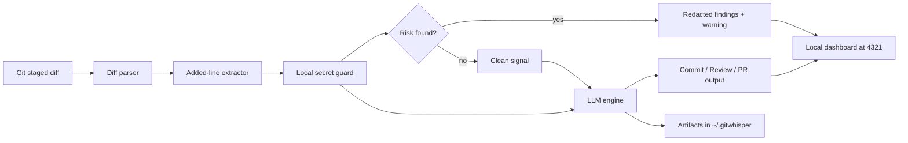
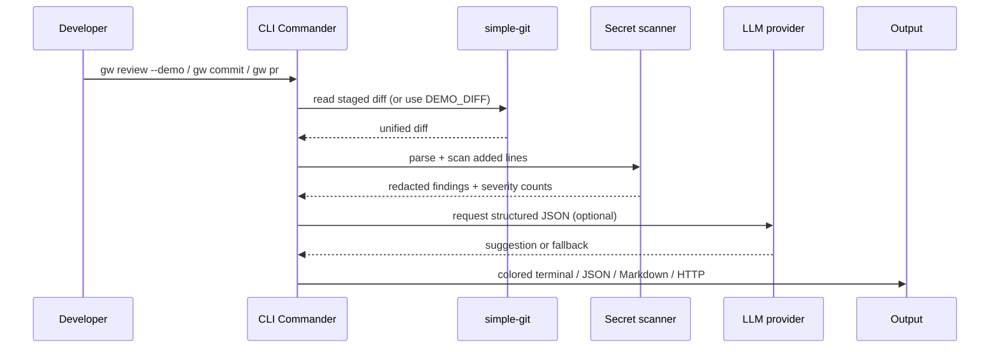

# GitWhisper Architecture

GitWhisper is a local-first CLI with an optional local dashboard. The important design rule is simple: **the secret scanner always runs locally, and its findings are never overridden by a language model**.

## High-level flow



## Command pipeline



## Module boundaries

| Layer | Files | Responsibility |
| --- | --- | --- |
| CLI | `src/cli/index.ts`, `src/cli/commands/*.ts` | Argument parsing, interactive Clack prompts, exit codes, user-facing output |
| Git | `src/core/git.ts` | Read staged/working diffs, parse hunks, chunk large diffs, recent history, artifacts |
| Security | `src/core/scanner.ts` | Curated regex rules, generic credential patterns, Shannon entropy, redaction |
| Insight | `src/core/insights.ts` | Deterministic heuristics and safe LLM enrichment for commit/review/PR |
| LLM | `src/core/llm/*.ts` | Provider adapters, strict JSON prompts, parse-and-validate helper |
| Config | `src/core/config.ts` | Env-first configuration, local JSON storage, masked views |
| Dashboard | `src/ui/*.ts`, `web/src/*` | Local HTTP API, static assets, React + Tailwind UI |

## Security model

1. **Scan before model calls.** Only added lines are inspected, which keeps reports focused on what the developer is about to commit.
2. **Values are redacted.** Findings expose the first and last four characters only; reports, dashboard cards and LLM prompts use the redacted form.
3. **Local findings win.** If a model returns a higher review score than the local heuristic score, the lower local score is kept.
4. **No silent network use.** `--demo`, `--offline`, missing keys and `offline` provider all force deterministic local heuristics.
5. **Config stays local.** Keys live in `~/.gitwhisper/config.json` with `0o600` permissions where the OS supports it, and environment variables can override stored values in CI.
6. **Localhost only.** The dashboard binds to `127.0.0.1`; it never listens on a public interface.

## LLM provider strategy

All providers share one interface:

```ts
interface LlmProvider {
  name: ProviderName;
  model: string;
  configured: boolean;
  generate(system: string, user: string): Promise<{ text: string; engine: string }>;
}
```

Native `fetch` is used for Gemini, OpenAI, Anthropic and Ollama. Prompts request a single strict JSON object. If the response is invalid, malformed or unavailable, GitWhisper returns the offline heuristic result with an `engine` string that explains the fallback — the command still succeeds.

## Large diffs

`parseDiff` produces file/hunk/line metadata. `chunkDiff` groups whole files into chunks of at most 12,000 characters by default, so a single file is never split mid-line. Prompts cap incoming diff text to keep token use predictable.

## Dashboard data flow

`GET /api/summary` combines the last 50 commits, the current branch, staged/working diff and secret counts into a `RepoSummary`. `GET /api/review` runs the same local heuristic review used by the CLI. `GET /api/config` returns a masked configuration view. The server first tries `web/dist`, then falls back to an embedded HTML dashboard, so the CLI still works before the React app is built.

## Extension points

- Add a provider in `src/core/llm/provider.ts` and a prompt in `prompts.ts`.
- Add a secret rule to `RULES` in `src/core/scanner.ts`.
- Add a command under `src/cli/commands/` and register it in `src/cli/index.ts`.
- Add dashboard cards by extending `RepoSummary` and `web/src/App.tsx`.
